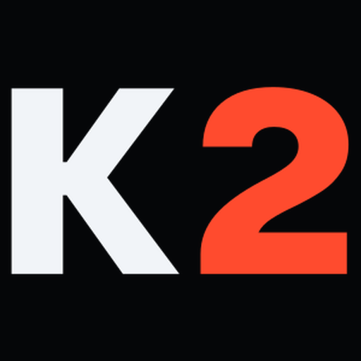
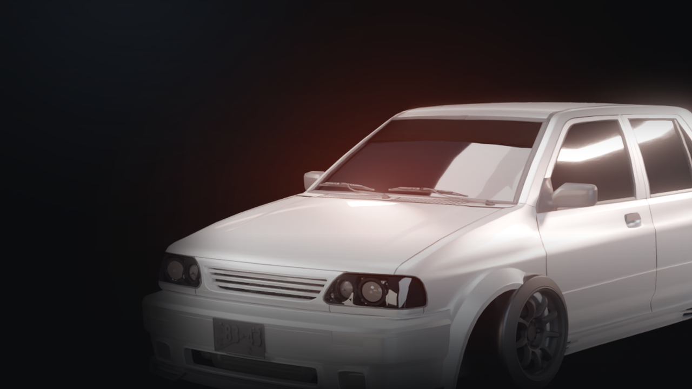
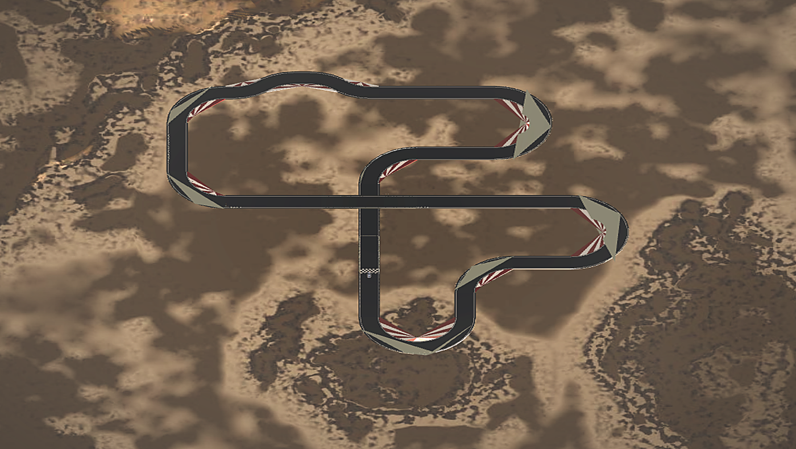
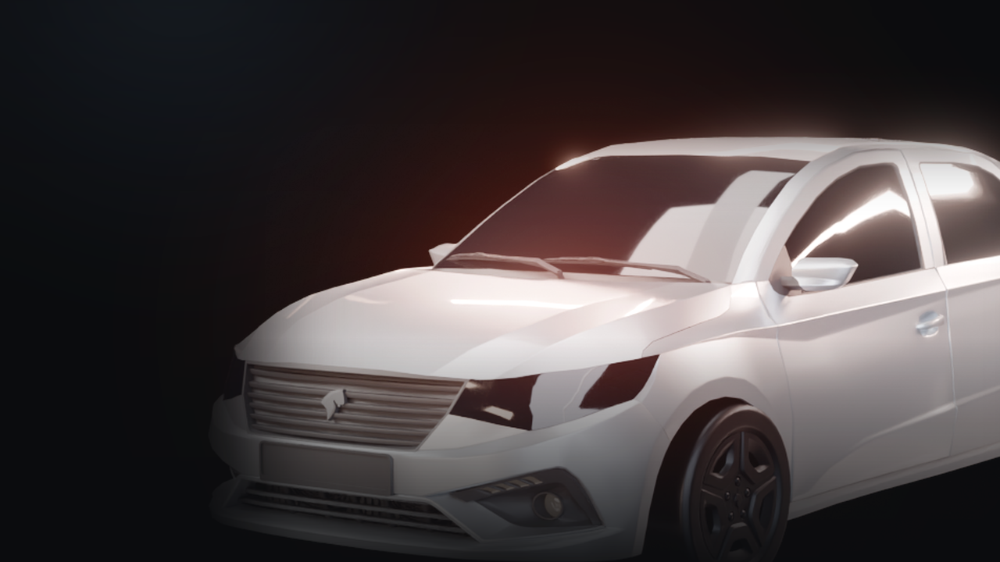
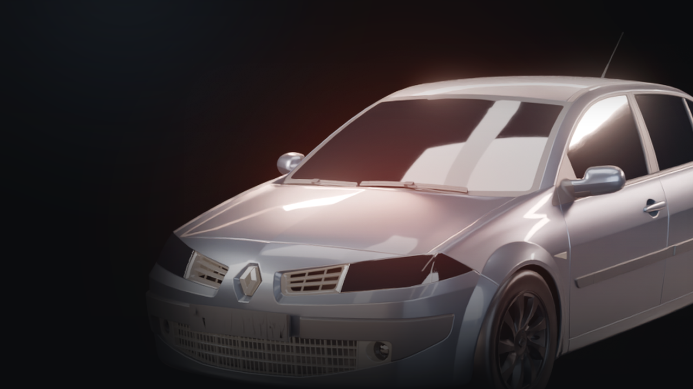

# Kilometer 2

**Kilometer 2** is a Persian (RTL) 3D driving game built with **Godot 4.7** for desktop and Android. The player picks one of six Iranian-market cars in a live 3D showroom, then drives it solo or with a friend over local Wi-Fi / Android hotspot (LAN multiplayer) on a desert circuit with Jolt vehicle physics, lap timing and sector checkpoints, a single smooth free-follow camera, and a unified dark-sport UI.

This repository is the cleaned, audited, fully documented production source (version **v0.3-b2-android-lan**: Build 2 Android LAN multiplayer fixes — non-Gradle manifest permissions, explicit IPv4 ENet bind, `/24` unicast discovery sweep, and async vehicle-handshake race fix on top of the desert circuit map, clean-road visuals, and identity-v2 loading screen). It is the single authoritative source of the project.

## Gallery

<p align="center">
  
  
</p>

| | |
|---|---|
|  |  |
| Sport Pride — default vehicle | The 973 m desert circuit |
|  |  |
| IKCO Tara | Renault Megan |

Full set (K2 mark, boot splash, adaptive + launcher icons, all six cars, portrait variants):
**[`docs/gallery/README.md`](docs/gallery/README.md)** — brand palette, source paths, and how to
regenerate real gameplay screenshots with `tools/capture_previews.gd` / `qa/capture_uiux.gd`.

## Overview

- **Desert-garage showroom (v0.1-b4).** The main-menu showroom is staged inside the
  "Car Garage | Desert Garage Environment" diorama (CC BY-NC 4.0, DevPoly3D), shipped as a
  1.4 MB optimised mesh (6.0 MB → 1.4 MB, 10 315 → 5 458 triangles, textures capped at
  512 px; see `assets/environment/garage/OPTIMIZATION_VERIFICATION.md`): dark night-workshop
  grade, the car's wheels resting on the model's own turntable, the orbit camera inside the
  workshop. The v0.1-b3 procedural hangar is kept as a fallback/comparison stage
  (`godot --path . -- --hangar-stage`). See `THIRD_PARTY_ASSETS.md` §6 for the licence terms.
- **Showroom-first flow.** Vehicle selection happens only in the main-menu 3D showroom (prev/next, rotating stage, live specs). The choice is persisted and locked for the whole driving session — there is no in-game vehicle switching anywhere.
- **One camera.** A single free-follow chase camera (SpringArm3D) with adjustable FOV, smoothing and distance. No camera modes, no switching.
- **One settings system.** One shared settings panel (menu + pause) backed by a static ConfigFile store. Graphics tier is owned by settings alone and is applied at scene start or on explicit user change — never as a side effect of spawning/switching anything.
- **Six vehicles.** Sport Pride (baseline default), IKCO Tara, Renault Megan, Saipa Pride 132, Saipa Quick, IKCO Samand EF7 — each with real measured mass, wheelbase and wheel radius.
- **Persian RTL UI — "Proving Ground" design system.** One token-driven theme (`UiTheme`), Estedad typography, explicit RTL paragraphs, Persian digits in prose and Latin digits in instruments, focus-trapped overlays, device-aware prompts (keyboard / gamepad / touch), UI scale 85–150 % and reduced motion. Android multi-touch controls (buttons / rotary wheel / analog bar), keyboard and gamepad support. See `documentation/DESIGN_SYSTEM.md` and `documentation/UX_ARCHITECTURE.md`.
- **Desert circuit.** A figure-eight desert track (commissioned GLB, optimised for mobile) with surveyed collision, 12 sector checkpoints, start-lights countdown and lap timing.
- **Local LAN multiplayer (v0.3).** Two-device play over local Wi-Fi or Android mobile hotspot without internet: automatic UDP host discovery (directed subnet broadcast + hotspot `.1` gateway probe + periodic beacons), manual IP entry with Persian/Arabic numeral normalization, and 30 Hz kinematic replica sync.

## Objectives

1. A stable, maintainable Godot project that another experienced developer can open, understand and extend without archaeology.
2. One authoritative implementation per system (UI, camera, settings, vehicle, input, LAN session).
3. Verified quality: **20 headless test suites** (900+ automated checks, 0 failures expected when run with Godot 4.7.2).

## Godot version & requirements

| Item | Value |
|---|---|
| Engine | Godot **4.7.2-stable** (project feature tag `4.7`; do not open with Godot 3.x) |
| Renderer | GL Compatibility (`gl_compatibility`, desktop + mobile) |
| Physics | Jolt Physics, 60 ticks/s |
| OS (dev) | Windows / Linux / macOS with the Godot 4.7 editor |
| Runtime | Desktop, or Android (export preset included, min. armeabi-v7a / arm64-v8a) |
| Display | 1280×720 design resolution, `canvas_items` stretch, expand aspect |

No third-party addons/plugins are required. External assets: the Estedad and Changa fonts (OFL-1.1), the vehicle models and the showroom
garage diorama (CC BY-NC 4.0, not for commercial release as-is) — see `LICENSES.md`,
`THIRD_PARTY_ASSETS.md` and `documentation/ASSET_CATALOG.md`.

> **Licence attribution (required):** This work is based on "Car Garage | Desert Garage
> Environment" by DevPoly3D (Sketchfab), licensed under CC-BY-NC-4.0.
> https://sketchfab.com/3d-models/car-garage-desert-garage-environment-ef8bb81713814d688487a81ae2467a51 UI icons and the instrument cluster are drawn in code.

## Installation & opening the project

1. Install Godot 4.7.2-stable from [godotengine.org](https://godotengine.org/download/) (or use the matching binary).
2. Clone/copy this folder anywhere. The folder name itself does not matter; `project.godot` is the project root.
3. Open Godot → **Import** → select `project.godot` → **Import & Edit**.
4. Wait for the first import to finish. On a completely cold cache you may see a one-time font error in the output while the font is still importing; running the import a second time completes cleanly with 0 errors (verified).

## Running the game

- **From the editor:** press ▶ (F5). The main scene is `res://scenes/ui/main_menu.tscn`.
- **From the command line:**
  ```bash
  godot --path .            # run
  godot --headless --path . --import   # import only
  ```
- **Showroom stage flags:** the desert-garage diorama is the default stage; pass
  `-- --hangar-stage` to stage the v0.1-b3 procedural hangar instead (comparison captures,
  or if the diorama has to be dropped for a commercial release), and `-- --no-shadows` to
  turn the diorama's shadow casting off (mobile performance testing).
- **Controls (desktop):** W/↑ throttle, S/↓ brake/reverse, A/D or arrows steering, Space handbrake, R reset vehicle, Esc/P pause. On Android, equivalent multi-touch pads are shown.

## Running the tests

Twenty headless SceneTree suites live in `tests/` (`bash qa/run_tests.sh` prints a summary):

```bash
for t in tests/test_*.gd; do godot --headless --path . --script "res://$t"; done
```

Rendering-dependent captures use Xvfb + OpenGL3 via the maintained tool:

```bash
xvfb-run godot --path . --script res://tools/capture_previews.gd --rendering-driver opengl3
# writes the official review screenshots to reports/screenshots/

# v0.1-b3/b4 before/after matrix (7 window configurations, every overlay):
xvfb-run -a -s "-screen 0 2600x1440x24" godot --path . --script res://qa/capture_uiux.gd \
    --rendering-driver opengl3 -- --out=/abs/output/dir
```

Android release signing: the keystore path is in `export_presets.cfg`; the user/password are
**not** stored in the repository — enter them in the editor's Export dialog (saved to the
git-ignored `.godot/export_credentials.cfg`) or set `GODOT_ANDROID_KEYSTORE_RELEASE_USER` /
`GODOT_ANDROID_KEYSTORE_RELEASE_PASSWORD`.

## Project layout

```
Kilometer 2/
├── project.godot            # engine config (main scene, input, rendering)
├── export_presets.cfg       # Android export preset
├── README.md / CHANGELOG.md / LICENSES.md
├── documentation/           # ARCHITECTURE, DEVELOPMENT, CLEANUP_REPORT, DESERT_CIRCUIT,
│                            # TESTING, ASSET_CATALOG, MAINTENANCE
├── scenes/                  # camera/ main/ multiplayer/ preview/ track/ ui/ vehicle/
├── scripts/                 # mirrors scenes/ (camera/ main/ multiplayer/ preview/ ...)
├── assets/fonts/            # Estedad + Changa (used), Vazirmatn (kept, unused) — all OFL-1.1
├── assets/vehicle/          # Sport Pride GLBs + carpack/ (5 vehicles)
├── assets/track/            # desert circuit GLB (optimised) + surveyed centreline.json
├── tests/                   # 20 headless suites (900+ checks)
├── qa/                      # run_tests.sh, capture_uiux.gd, probe_focus.gd (dev-only, export-excluded)
├── tools/                   # capture_previews.gd, capture_map.gd, sync_version.py,
│                            # track_survey/ (GLB optimiser + centreline survey, dev-only)
└── reports/                 # screenshots/ + test-output metrics (JSON)
```

Full details: `documentation/ARCHITECTURE.md`. Cleanup provenance: `documentation/CLEANUP_REPORT.md`. Testing evidence: `documentation/TESTING.md`.

## Repository meta

| Item | Value |
|---|---|
| Status | **v0.3-b2-android-lan** · Android versionCode **14** · LAN multiplayer on Wi-Fi / hotspot |
| Source version | `v0.3-b2-android-lan` (Android versionCode 14) |
| Engine | Godot **4.7.2-stable**, GL Compatibility, Jolt 60 Hz |
| Language of code | English (GDScript) · UI strings Persian (RTL) |
| **AI agents: start here** | **[`AGENTS.md`](AGENTS.md)** — repo map, run/test commands, mandatory conventions, asset-licence rules |
| Docs index | `documentation/ARCHITECTURE.md` → `DEVELOPMENT.md` → `DESIGN_SYSTEM.md` / `UX_ARCHITECTURE.md` → `TESTING.md` |
| Tests | `bash qa/run_tests.sh` (20 headless suites; 900+ checks, 0 failures expected) |

## License

Source code and procedural content: MIT (see `LICENSES.md`). Vehicle models and font carry their own terms — read `LICENSES.md` before any commercial publication.
