# 🖼️ گالری برند و تصاویر — Kilometer 2

لوگوی **K2**، آیکون‌ها و تصاویر داخل بازی (رندرهای نمایشگاه و نقشهٔ پیست).
همهٔ این فایل‌ها مستقیماً از منابع خود پروژه استخراج شده‌اند (بدون رتوش یا تغییر)، پس با آنچه در بازی می‌بینید یکی هستند.

---

## ۱. لوگو و هویت بصری

### آیکون اصلی

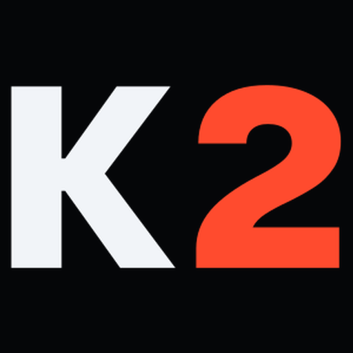

`docs/gallery/brand/01-app-icon-512.png` · ۵۱۲×۵۱۲
> منبع در پروژه: `assets/ui/brand/app_icon_512.png` (همان آیکونی که در `project.godot` به‌عنوان `config/icon` ثبت شده)

### نشان K2 (افقی)


`docs/gallery/brand/02-k2-mark.png` · ۲۹۳×۱۶۷ · منبع: `assets/ui/brand/k2_mark.png`

### اسپلش بوت (پس‌زمینهٔ مشکی مات)

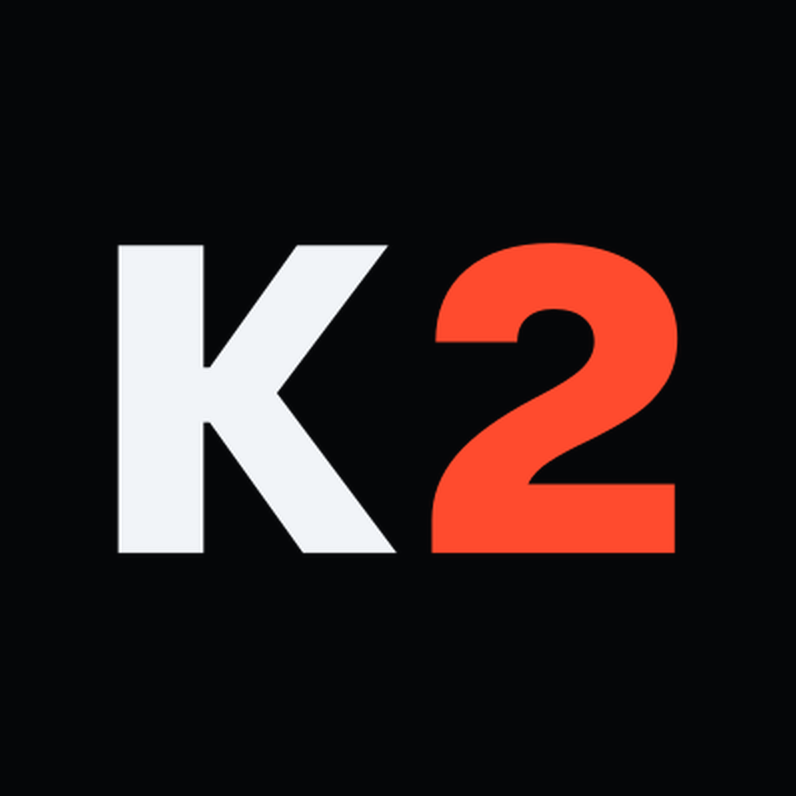

`docs/gallery/brand/03-boot-splash.png` · ۱۰۲۴×۱۰۲۴ · منبع: `assets/ui/brand/boot_splash.png`

### آیکون تطبیقی اندروید (لایهٔ پیش‌زمینه)

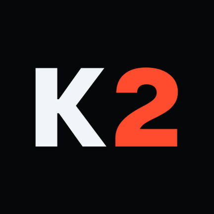

`docs/gallery/brand/04-app-icon-foreground.png` · ۴۳۲×۴۳۲ · منبع: `assets/ui/brand/app_icon_foreground_432.png`

### لانچر اندروید

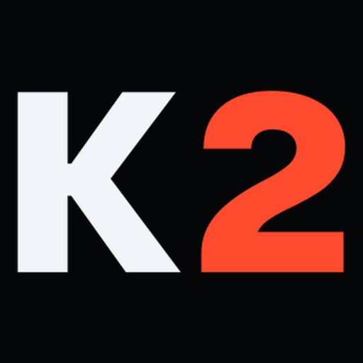

`docs/gallery/brand/05-android-launcher-512.png` · ۵۱۲×۵۱۲ · منبع: `android_icons/launcher_512.png`

### لوگوتایپ KILOMETER (سفید، برای پس‌زمینهٔ تیره)


`docs/gallery/brand/06-kilometer-logotype.png` · ۳۵۲۹×۶۰۰ · منبع: `assets/ui/loading/logo/kilometer_logotype_white.png`

> 🎨 **پالت برند:** مشکی مات `#050608` · سفید یخی `#F1F3F5` · قرمز برند `#E8412C`

---

## ۲. رندرهای داخلی بازی (صفحهٔ لودینگ / نمایشگاه)

### صفحهٔ معرفی (Intro)

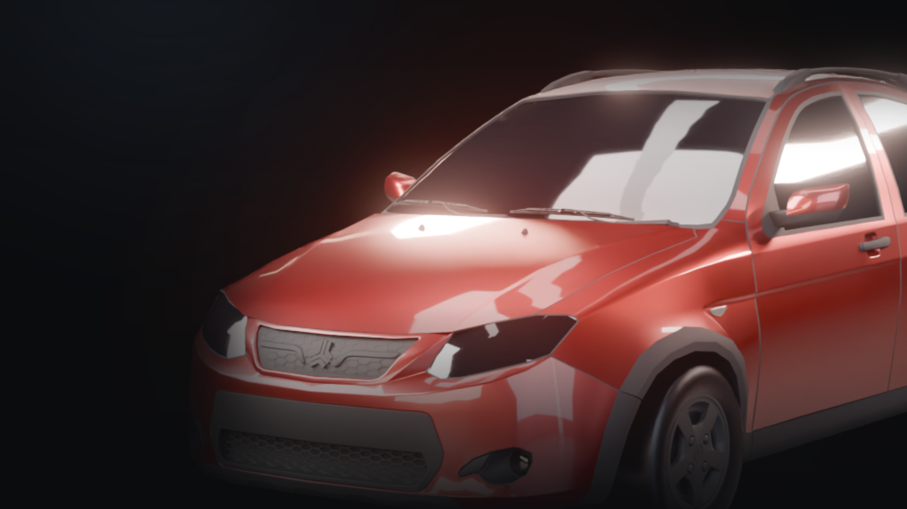

`docs/gallery/showroom/10-plate-intro.png` · منبع: `assets/ui/loading/plate_intro.png`

### نقشهٔ پیست بیابانی (۹۷۳ متر)

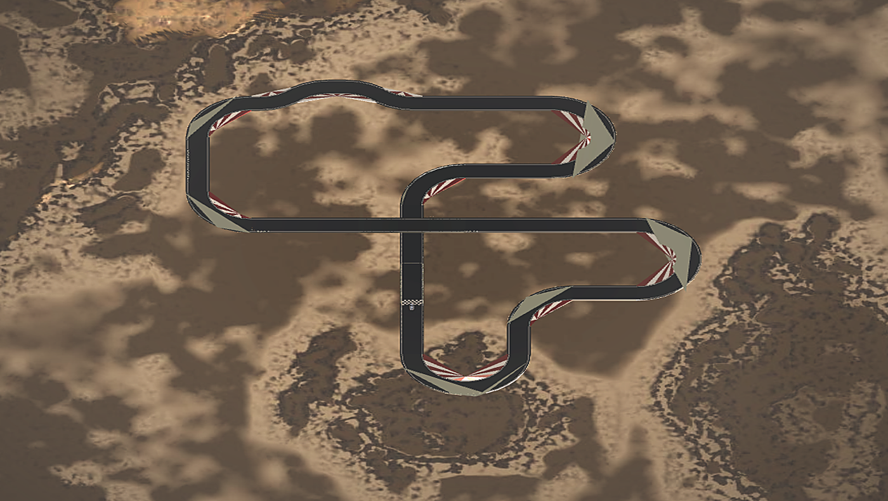

`docs/gallery/showroom/11-plate-track-map.png` · منبع: `assets/ui/loading/plate_map.png`

### Sport Pride (خودروی پیش‌فرض)

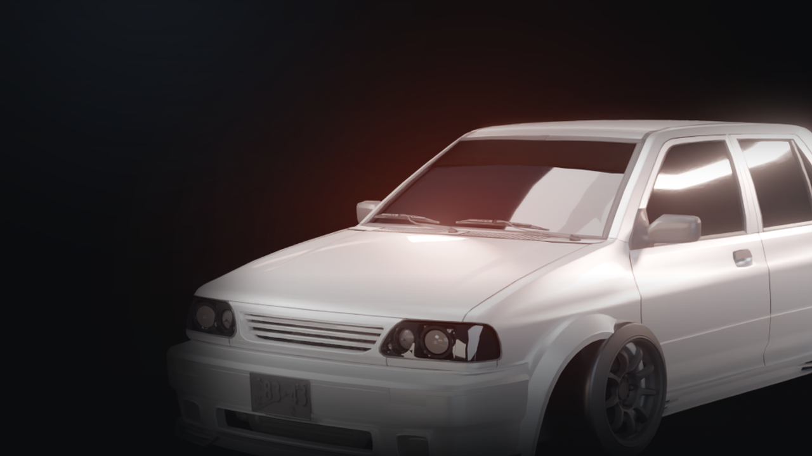

`docs/gallery/showroom/12-plate-sport-pride.png` · منبع: `assets/ui/loading/plate_pride.png`

### Saipa Pride 132

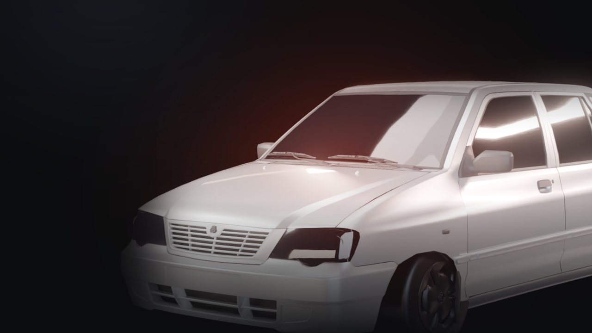

`docs/gallery/showroom/13-plate-saipa-pride-132.png` · منبع: `assets/ui/loading/plate_pride132.png`

### IKCO Tara

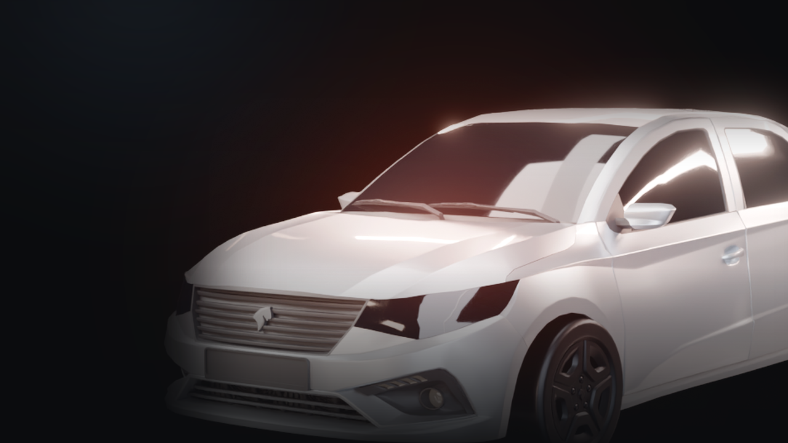

`docs/gallery/showroom/14-plate-ikco-tara.png` · منبع: `assets/ui/loading/plate_tara.png`

### Renault Megan

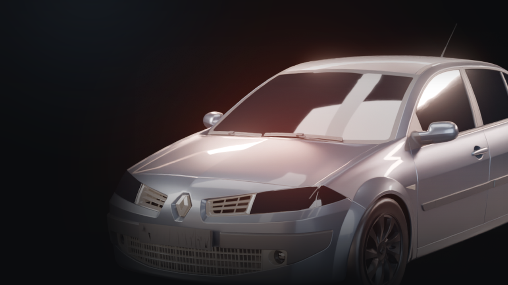

`docs/gallery/showroom/15-plate-renault-megan.png` · منبع: `assets/ui/loading/plate_megan.png`

### Saipa Quick

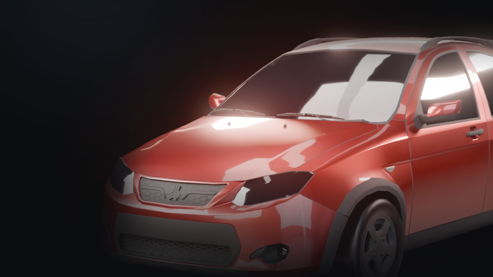

`docs/gallery/showroom/16-plate-saipa-quick.png` · منبع: `assets/ui/loading/plate_quick.png`

### IKCO Samand EF7

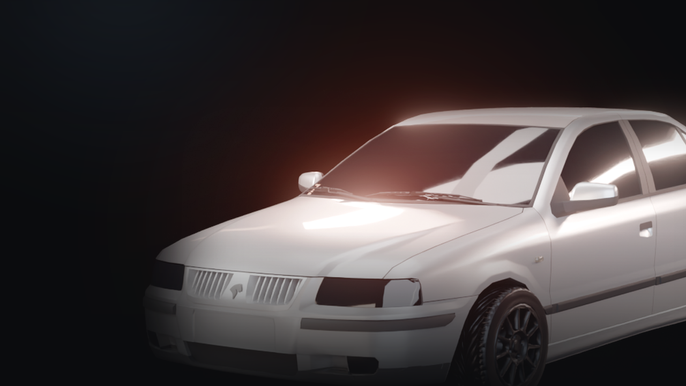

`docs/gallery/showroom/17-plate-ikco-samand-ef7.png` · منبع: `assets/ui/loading/plate_samand.png`

> نسخه‌های عمودی همین تصاویر برای موبایل با پسوند `_portrait` در `assets/ui/loading/` موجود است.

---

## ۳. اسکرین‌شات‌های گیم‌پلی واقعی (Diorama + HUD)

اسکرین‌شات‌های رندر بازی (**نمایشگاه سه‌بعدی، دوربین تعقیب، HUD فارسی**) با اسکریپت‌های خود پروژه گرفته می‌شوند و
عمداً در مخزن کامیت نشده‌اند (تصاویر تولیدی‌اند، نه سورس):

```bash
# رندر صحنه‌های رسمی بازبینی → reports/screenshots/
xvfb-run godot --path . --script res://tools/capture_previews.gd --rendering-driver opengl3

# ماتریس ۷ حالت پنجره × همهٔ overlay ها
xvfb-run -a -s "-screen 0 2600x1440x24" godot --path . \
  --script res://qa/capture_uiux.gd --rendering-driver opengl3 -- --out=/abs/output/dir
```

اگر خواستی خروجی‌ها را داخل مخزن داشته باشیم، بعد از اجرا با
`git add -f reports/screenshots` آن‌ها را اضافه کن (پوشهٔ `reports/` git-ignored است).

---

## مجوز

این تصاویر اجزای پروژهٔ Kilometer 2 هستند: کد و محتوای رویه‌ای **MIT**.
مدل‌ها و رندرهای خودروها و دیورامای گاراژ مجوز خودشان را دارند — پیش از هر استفادهٔ تجاری
`LICENSES.md` و `THIRD_PARTY_ASSETS.md` را بخوانید (دیورامای DevPoly3D: **CC BY-NC 4.0**).
